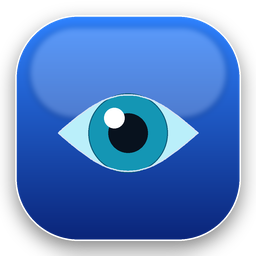

<p align="center">
  
</p>

<h1 align="center">Vigil</h1>

<p align="center">
  <b>מונע מהמחשב להיכנס למצב שינה או נעילה — קל, שקט, ובלי הרשאות מנהל.</b><br>
  <b>Keeps your Windows PC awake and unlocked — tiny, quiet, no admin rights.</b>
</p>

<p align="center">
  
  
  
  
</p>

---

## עברית

### מה זה עושה
Vigil יושב באזור ההודעות שליד השעון (System Tray) ומונע מהמחשב להינעל או לכבות את המסך כשאתה לא נוגע בו — למשל כשסרטון יוטיוב ארוך מתנגן בדפדפן, כשמשהו רץ ברקע, או כשאתה פשוט לא רוצה שהמחשב יינעל.

הכלי בנוי להתמודד גם עם **מדיניות קשוחה של מחלקת IT** בחברות גדולות (נעילה כפויה אחרי כמה דקות של חוסר פעילות), ועושה זאת באמצעות ממשקי Windows רשמיים ומתועדים בלבד — כך שהוא אינו נראה כתוכנה עוינת ואינו מתנגש עם תוכנות האבטחה של הארגון.

### שימוש
- **לחיצה שמאלית** על הסמל — הפעלה / כיבוי של מניעת הנעילה.
- **לחיצה ימנית** על הסמל — תפריט הגדרות מלא.
- הסמל משתנה לפי המצב: **עין פקוחה זוהרת** = פעיל, **עין עצומה** = מושהה.

### התפריט (לחיצה ימנית)
| הגדרה | מה היא עושה |
|---|---|
| מניעת נעילה | הפעלה/כיבוי כללי (זהה ללחיצה שמאלית) |
| להשאיר את המסך דולק | מונע גם כיבוי מסך, לא רק נעילה |
| שיטת סימולציה | F15 (מומלץ) · הקשת Scroll Lock · הזזת עכבר |
| תדירות פעימה | כל 30 / 50 / 59 / 120 שניות |
| פעילות מתוקצבת | פעיל ל-30 דק׳ / שעה / שעתיים / 4 שעות ואז כיבוי אוטומטי |
| פעיל בעת ההפעלה | מצב ברירת המחדל כש-Vigil עולה |
| הפעלה עם Windows | הוספה לרשימת ההפעלה האוטומטית (למשתמש הנוכחי, בלי מנהל) |
| שפה | English / עברית |

### איך זה עובד (בקצרה)
נעילה כפויה של הארגון נקבעת לפי **זמן חוסר הפעילות של הקלט** (מה שחלון מודד דרך `GetLastInputInfo`). Vigil משלב שתי שכבות:
1. `SetThreadExecutionState` — אומר ל-Windows "אל תיכנס לשינה / אל תכבה מסך".
2. **פעימת קלט זעירה ותמימה** כל כמה עשרות שניות (כברירת מחדל מקש **F15**, שאף תוכנה לא משתמשת בו, ולא מזיז את העכבר ולא מפריע לעבודה) — מאפסת את מד חוסר הפעילות, וכך מונעת את הנעילה הכפויה.

### התקנה
אין צורך בהתקנה. מורידים את `Vigil.exe` מ[עמוד ההורדות](../../releases/latest) ומריצים. כדי שיעלה אוטומטית בכל הדלקה — פותחים את התפריט הימני ומסמנים "הפעלה עם Windows".

> הקובץ אינו חתום דיגיטלית, ולכן ייתכן ש-Windows SmartScreen יציג אזהרה בהרצה הראשונה: *More info → Run anyway*.

---

## English

### What it does
Vigil lives in the Windows system tray and stops your PC from locking or turning off the screen while you're away — e.g. during a long YouTube video, a background job, or whenever you just don't want the machine to lock.

It is built to handle **strict corporate IT policy** on managed laptops (a forced lock after a few idle minutes), using only official, documented Windows APIs — so it doesn't look hostile and doesn't fight the organisation's security software.

### Usage
- **Left click** the tray icon — toggle keep-awake on/off.
- **Right click** — the full settings menu.
- The icon reflects state: **glowing open eye** = active, **closed eye** = paused.

### The menu (right click)
| Setting | What it does |
|---|---|
| Keep awake | Master on/off (same as left click) |
| Keep the screen on | Also prevents the display from turning off |
| Simulation method | F15 key (recommended) · Scroll Lock tap · Mouse nudge |
| Pulse interval | Every 30 / 50 / 59 / 120 seconds |
| Timed session | Stay awake for 30 min / 1 h / 2 h / 4 h, then auto-off |
| Active when Vigil starts | Default state when Vigil launches |
| Start with Windows | Per-user startup entry (no admin) |
| Language | English / Hebrew |

### How it works
A corporate forced lock is driven by the **input idle timer** (what Windows reports through `GetLastInputInfo`). Vigil combines two layers:
1. `SetThreadExecutionState` — tells Windows to keep the system and display awake.
2. A **tiny, benign input pulse** every few dozen seconds (default: the **F15** key — used by no application, no cursor movement, no interference) — which resets the idle timer and defeats the forced lock.

### Install
No installer. Download `Vigil.exe` from the [latest release](../../releases/latest) and run it. To launch at every boot, open the right-click menu and tick **Start with Windows**.

> The binary is not code-signed, so Windows SmartScreen may warn on first run: *More info → Run anyway*.

### Footprint
Native Win32, a single static executable (~140 KB), idle CPU ≈ 0%, a few MB of RAM. No network access, no admin rights, settings stored in `%APPDATA%\Vigil\settings.ini`.

---

## Build from source

**On Windows** (Visual Studio Build Tools *or* MinGW-w64 on PATH):
```powershell
pwsh ./build.ps1          # -> build/Vigil.exe
```

**Cross-compile from Linux/macOS** (MinGW-w64):
```bash
./scripts/build-mingw.sh  # -> build/Vigil.exe
```

The icon is generated from `scripts/make_icons.py` (needs Python + Pillow); the
committed `.ico` files in `assets/` are already up to date.

## Project layout
```
src/main.cpp        core application (single file)
src/vigil.rc        icons, version info, manifest
src/vigil.manifest  asInvoker, per-monitor DPI, Win10/11
assets/             generated .ico (active + paused) and previews
scripts/            icon generator + cross-compile script
build.ps1           Windows build (MSVC or MinGW)
.github/workflows/  CI build + release on version tags
```

## License
MIT — see [LICENSE](LICENSE).
